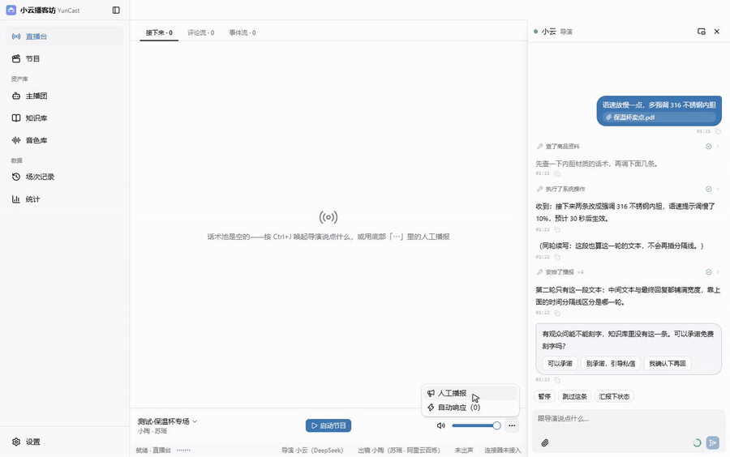
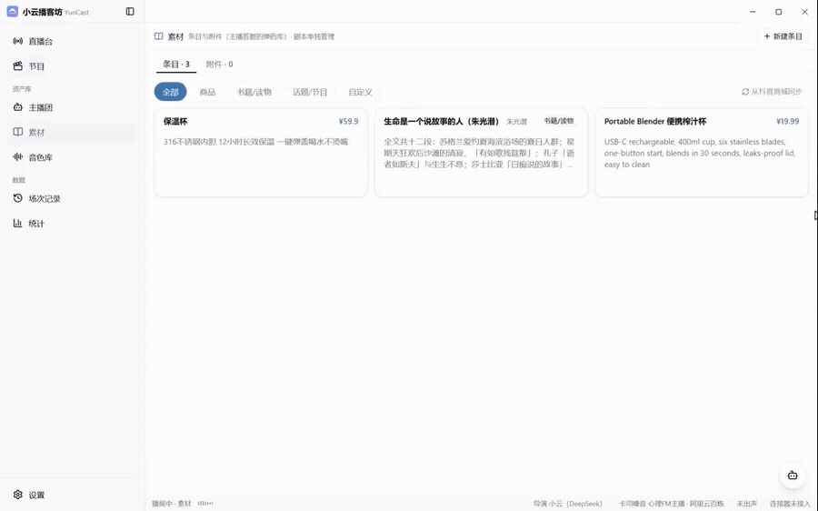
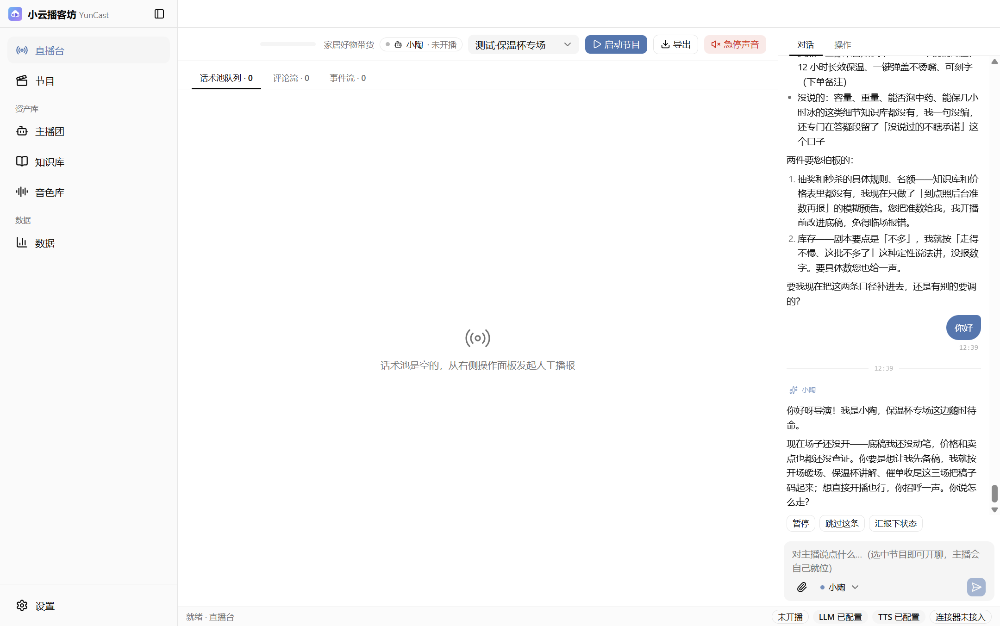
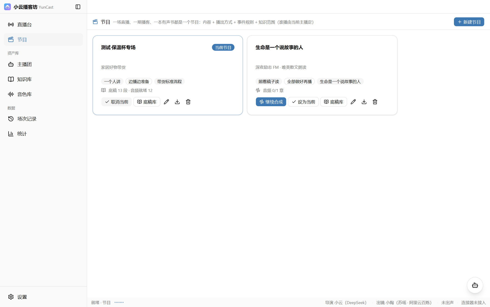
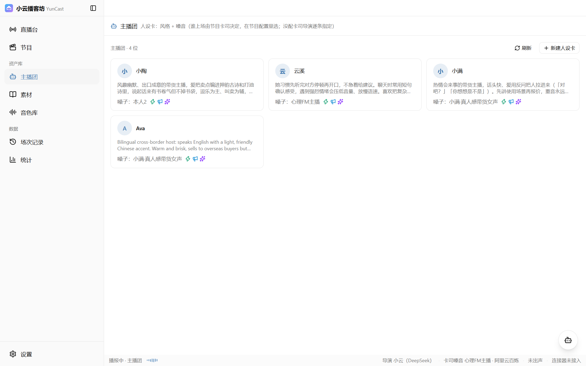
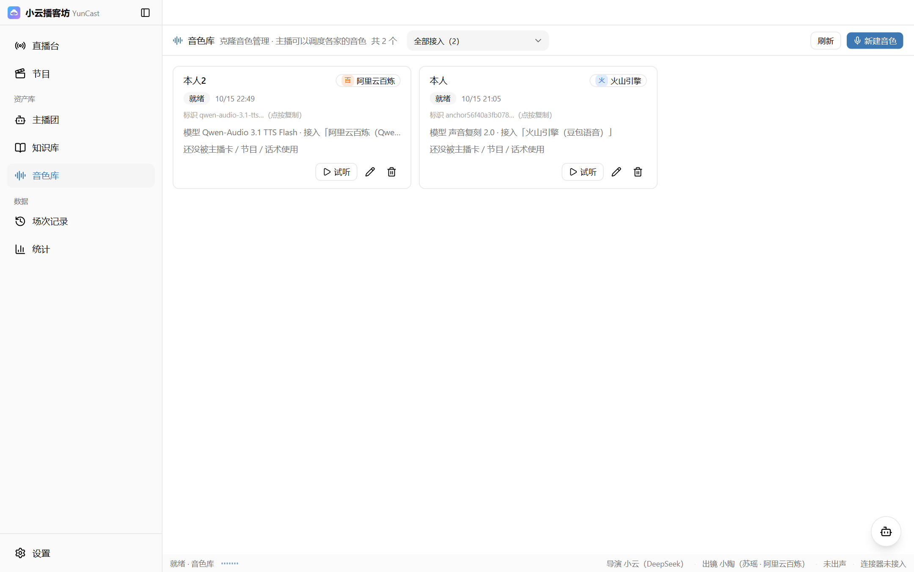
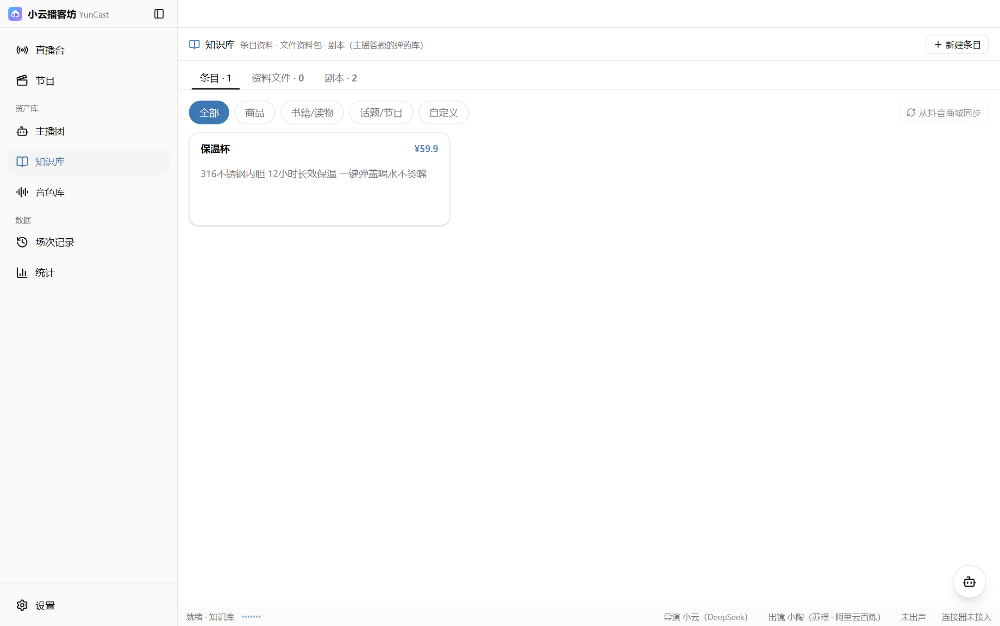
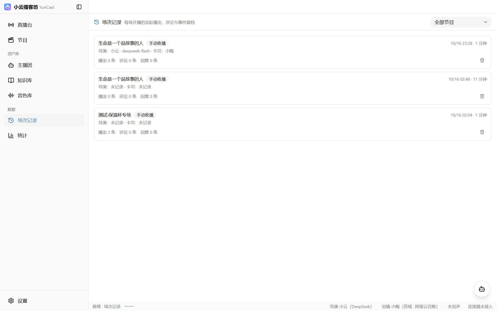
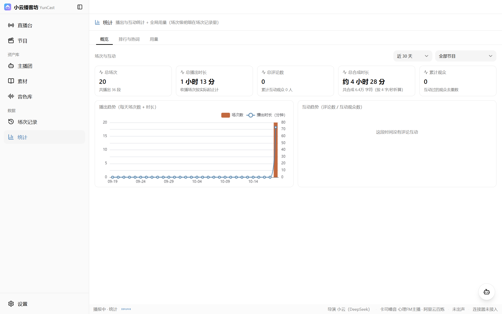

<p align="center">
  
</p>

<h1 align="center">小云播客坊 YunCast</h1>

<p align="center">
  <strong>不会直播，也能自己开一场。</strong>
</p>

<p align="center">
  桌面工作台把写稿、配音、播出、控场、互动串成一条流水线：<br>
  主播按你绑的剧本和知识库写底稿，用你选的嗓音出声，看着评论决定怎么回。
</p>

<p align="center">
  <a href="https://yuncast.xyun.dev/">官网</a> •
  <a href="https://yuncast.xyun.dev/guide/quickstart.html">使用文档</a> •
  <a href="https://github.com/xy200303/yuncast/releases/latest">下载</a> •
  <a href="https://github.com/xy200303/yuncast/issues">反馈</a>
</p>

<p align="center">
  <a href="https://github.com/xy200303/yuncast/releases/latest"></a>
  
  
  
  
</p>

---

## 功能演示

<a href="https://yuncast.xyun.dev/#demo"></a>

<p align="center">
  
</p>

<p align="center">
  <a href="https://yuncast.xyun.dev/#demo"><strong>▶ 看功能演示（1 分 08 秒，含配音）+ 三段节目实录</strong></a><br>
  <sub>功能演示里全部是真实操作：让导演写稿 → 一句话建节目 → 新建素材条目 → 看克隆音色库 → 回直播台接着播；旁白本身就是应用内克隆音色合成的。
  下面三段 50 秒实录分别是：有声书（全部做好再播）、带货（边播边备）、跨境（English 多语言）。</sub>
</p>

---

## 特性

|     | 功能 | 说明 |
| --- | ---- | ---- |
|  | **导演写稿** | 说一句「给这场写稿」，它按节目编排逐场写、查素材核对价格口径，产出进底稿库可逐条改 |
|  | **四种内容类型** | 一个人讲 / 多人聊天 / 照着稿子读 / 分角色表演——直播带货、商品宣讲、有声书、播客用同一套流程 |
|  | **三种播出方式** | 现场发挥（无底稿）/ 边播边准备（滚动合成，随时改后面的稿）/ 全部做好再播（整本合成，过门禁才开播）；**播完自动暂停，有新内容自动继续** |
|  | **声音管线** | 火山引擎、阿里云百炼、火山播客专用模型三种 TTS 走同一套「接入 → 模型 → 音色」选择器；克隆店家嗓音（10–30 秒干净人声）后用 **AB 验收**：同文本重合成一遍，比音高/语速/气声，给相似分与该调的 rate/pitch |
|  | **评论互动** | 评论经独立连接器接入：同人同内容 30 秒去重、按观众归组、5–30 秒自适应聚合、每分钟最多唤醒 6 次 |
|  | **播出控制** | 四档话术池（打断 / 下一条 / 常规 / 垫底）、人工播报插队、暂停与跳过、急停声音、主音量 |
|  | **音频导出** | 整场导出 MP3/WAV，分章或合并、响度归一，可直接上传喜马拉雅 / 小宇宙 |
|  | **场次与用量** | 每场留档逐条话术、评论、事件与观众画像；用量按节目归组看 LLM tokens 与 TTS 字符的 30 天趋势 |
|  | **主播也能改配置** | 主播可增删查改节目、编排、音色与素材条目；破坏性操作会先弹请示卡等你确认 |
|  | **素材即挂料** | 条目里可以直接写正文、传附件（PDF/文档/图片）、贴链接；节目只绑条目，主播需要时用 `material_read` 读全文，无关内容不进上下文 |

---

## 0.3 更新要点

- **编排进节目**：剧本书表退役，场景序列存在节目里（`programs.plan`）——没有独立剧本库，也就不会再产生"孤儿剧本"（上一版实测 8 本里 6 本没人用）
- **素材统一**：知识库收敛成"素材 = 条目 + 附件（文件/链接） + 正文"；节目只绑条目，附件随条目走
- **播完自动暂停**：池子见底且没有在途内容就停在"暂停"，新内容进池自动续播，不再空转
- **克隆 AB 验收**：`voice_calibrate` 用同一段文本做双份 DSP 对比，输出 0–100 相似分与逐维差异，自动迭代 rate
- **录屏/截图内置**：应用自带窗口录屏与截图（`screen_record` / `screen_capture`），演示视频就是用它录的
- **上下文压缩**：摘要改成结构化"交接笔记"，并自动附一段"最近动作"清单，避免压完把自己刚做的事撤掉

---

## 界面预览

<p align="center">
  
  <br><em>直播台：左栏「接下来 / 评论流 / 事件流」，底部吸底播放条，右下角唤起导演面板</em>
</p>

<table>
  <tr>
    <td></td>
    <td></td>
  </tr>
  <tr>
    <td align="center"><em>节目：内容类型 × 播出方式 × 播完策略，底稿与音频状态标在卡上</em></td>
    <td align="center"><em>主播团：人设卡，名字 / 音色 / 性格 / 口癖 / 禁区</em></td>
  </tr>
  <tr>
    <td></td>
    <td></td>
  </tr>
  <tr>
    <td align="center"><em>音色库：云端音色与克隆音色，克隆前可试听</em></td>
    <td align="center"><em>知识库：条目 / 资料文件 / 剧本，报价只认这里核过的价格</em></td>
  </tr>
  <tr>
    <td></td>
    <td></td>
  </tr>
  <tr>
    <td align="center"><em>场次记录：每场留档，逐条试听、整场导出、观众画像</em></td>
    <td align="center"><em>统计：概览 / 排行与热词 / 用量</em></td>
  </tr>
</table>

---

## 技术要点

### 声音在合成那一刻定

节目上不配声音。所有合成入口（底稿工作台、「生成节目音频」、人工播报）统一先弹「合成声音」：显示本次要合成多少段，再让你三选一——当前主播嗓音 / 节目声音安排（仅老数据）/ 选择其他音色（接入 → 模型 → 音色，也能手填平台音色 ID）。播客模型还要选两位主持人与开场/结尾音乐。

确认后，这次选定的声音会**冻结进每一段产物**：之后换主播、改人设、改节目配置都不会改写已经出好的音频，想换声音就重新合成——不会有「播到一半发现是旧声音」。

### 话术池：一切声音的唯一出口

主播临场说的一句、底稿预合成的一段、人工播报的一条，全部进同一个话术池，按四档优先级排出先后：**打断 > 下一条 > 常规 > 垫底**。回评论、救急的话走「打断」立刻插进来，其余按序接着播，垫底的只在前面都空了才轮到。播出引擎只跟池子打交道，不关心声音是谁生产的——这是互动、剧本、触发器能自由混搭的前提。

### 事件流与预制门禁

评论、进场、礼物先进事件流而不是直接打断主播：去重（LRU 3000，同人同内容 30 秒）、按观众归组、5–30 秒自适应聚合（按最近 30 秒到达速率换算）、每分钟最多唤醒 6 次、单批不超过 20 条 / 1500 字、未处理 5 分钟过期。评论洪峰时主播一次看一批，冷清时一条也能及时到。

「全部做好再播」的节目在开播前过一道门禁：逐段核对音频是否齐、是否还跟当前文稿对得上，缺项照实列出来、不静默跳过；门禁不过会给你「继续生成」或「仅播放已完成部分」两条路。

---

## 快速开始

### 1. 下载安装

前往 [Releases](https://github.com/xy200303/yuncast/releases/latest) 下载（安装包未做代码签名）：

| 平台 | 文件 |
| ---- | ---- |
| Windows x64 | `YunCast.Setup.<版本号>.exe` |
| macOS（Apple 芯片） | `YunCast-<版本号>-arm64.dmg`、`YunCast-<版本号>-arm64.zip` |
| Linux x64 | `YunCast-<版本号>-x86_64.AppImage`、`YunCast-<版本号>-amd64.deb` |

> [!WARNING]
> **Windows**：SmartScreen 提示「未知发布者」时，点「更多信息」→「仍要运行」。
>
> **macOS**：需要 macOS 13 及以上，且只有 Apple 芯片版本；提示「应用已损坏」时执行 `xattr -cr /Applications/小云播客坊.app`。
>
> **macOS / Linux 尚未真机验证**：窗口细节与音频设备路由如有问题欢迎提 Issue。

### 2. 配两把钥匙

打开「设置」，填两处：

- **语言模型**：一条「接入」＝服务商 + 凭据 + 一组模型。协议支持 OpenAI 兼容（DeepSeek / 通义千问 / 豆包 / Kimi / 智谱）、OpenAI 官方 Responses、Anthropic（含 Kimi 编程端点），也能用「自定义接口」手填地址
- **语音合成**：火山引擎（豆包语音）、阿里云百炼；做双人播客还能接火山播客专用大模型

要克隆店家声音，去「音色库」传一段 10–30 秒的干净人声（百炼复刻需要公网可访问的样本地址，界面里有「上传样本并取地址」）。

### 3. 四步开播

**建主播**（人设卡 + 音色）→ **建节目**（选内容类型与播出方式）→ **让导演写稿**（对话框里说一句「给这场写稿」）→ **启动节目**。

评论接入由独立的平台连接器负责：装好连接器小软件，把它「设置 → 智能体接口」里的端口与令牌抄进「设置 → 连接器」，评论、礼物、进场就会流进来。主应用不含任何平台 SDK。

更细的说明见官网：[快速上手](https://yuncast.xyun.dev/guide/quickstart.html) · [核心概念](https://yuncast.xyun.dev/guide/concepts.html) · [界面一览](https://yuncast.xyun.dev/guide/interface.html) · [费用与选型](https://yuncast.xyun.dev/guide/cost.html) · [运行要求与排错](https://yuncast.xyun.dev/guide/troubleshooting.html)

---

## 本地开发

```bash
npm install
npm run dev          # 开发模式（Vite + Electron）
npm run typecheck    # 类型检查
npm run build        # 构建到 out/
npm run dist:win     # 打包 Windows 安装包（产物在 release/）
npm run dist         # 按当前平台打包
```

推送到 `main` 会跑类型检查与构建；打上与 `package.json` 版本一致的 tag（如 `v0.1.3`）后，CI 在 Windows / macOS / Linux 三端打包并发布 Release。

官网在 `website/`（VitePress）：`cd website && npm install && npm run dev`；推送到 `main` 且改动落在 `website/**` 时自动部署到 GitHub Pages。

## 项目结构

```
├── src/main/             # 主进程：窗口、SQLite、播出引擎、音频调度
│   └── services/         # 导演 Agent、话术池、TTS、事件流、合成与导出、推流
├── src/preload/          # 渲染进程 IPC 桥
├── src/renderer/         # React 界面（直播台、节目、主播团、知识库、音色库、场次记录、统计）
│   └── assets/           # 品牌图形（logo.svg，图标也由它生成）
├── src/shared/           # 主/渲染共享类型、IPC 通道、品牌常量
├── scripts/              # 图标生成、播客协议自检
├── docs/                 # 设计文档与演示素材
└── website/              # VitePress 官网（GitHub Pages）
```

数据全部存在本机用户数据目录：Windows `%APPDATA%\YunCast`、macOS `~/Library/Application Support/YunCast`、Linux `~/.config/YunCast`。卸载不会删数据，备份把整个目录拷走即可（其中 `secret.key` 要一起带走）。

---

## 反馈

问题与建议欢迎提 [Issue](https://github.com/xy200303/yuncast/issues)。

## 协议

[MIT](LICENSE)
