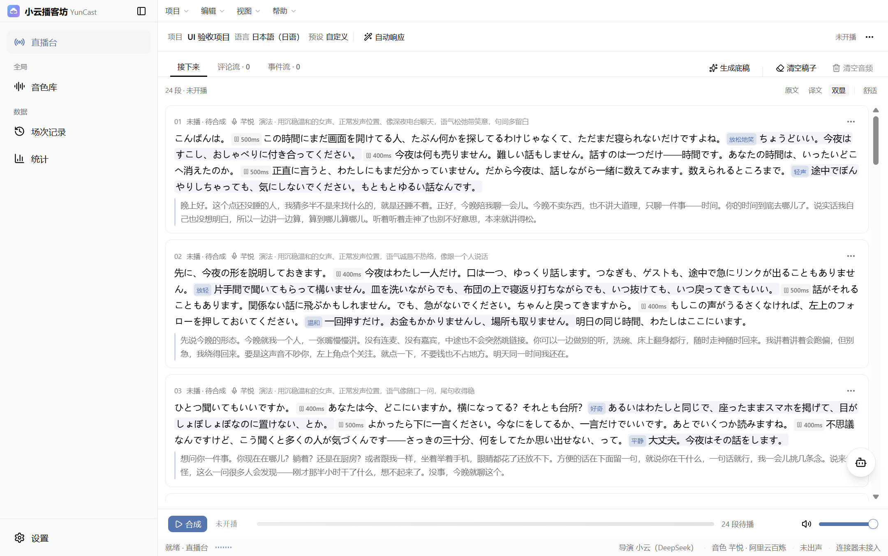

# 界面一览

左侧边栏从上到下是 **直播台**、**音色库**、**场次记录**、**统计**，底部是「设置」。侧边栏可以收成一列图标。

没有打开项目时，主区是启动页：新建项目 / 打开项目 / 打开文件夹，下面是最近打开的项目。顶部「项目」菜单多了导出与导入。

底部状态栏常驻：左边是「就绪 / 播报中 / 已暂停 · 当前页面」，右边依次是导演模型、嗓音路由、推流/出声、连接器状态。有段落在合成时会多一格「合成中 N」。

## 直播台

### 顶栏

只有状态，没有配置入口：

- **项目名** · **语言** · **预设**：纯文字；语言与预设在播出中锁定
- **自动响应**（按钮）：本场唯一的互动接线入口，弹窗里开关「让导演看到直播间动态」和各项自动响应，改完立刻生效，播出中也能调
- 右侧：`播出中 / 未开播` +「⋯」菜单（回到当前、导演对话、人工播报、录屏（带声音）；未开播时还有推流设置）

### 卡片流

主区一条卡片流，按**稿子顺序**排列，不按播放历史排：

- 卡片头：序号、状态（未播 / 在播 / 已播 / 待合成 / 合成失败）、时长、本段音色、演法
- 正文：原文全文，`<cot>` / `<pause>` / `<fx>` 渲染成小标签；下面附中文对照（外语场景）
- 右上「⋯」：试听、单独合成、改稿、跳过、撤销
- 单独合成时选「音色」即可：下拉里是音色库的名字（如「小满」），系统音色/手动 ID 收在「其他音色」里
- 改稿编辑的是**原文**，演法标记会保留；改完旧音频作废、重新合成

顶部标签是 `接下来 / 评论流 / 事件流`，评论与事件常驻，随时切回来。

### 播放条

- 左：播放/暂停标记、`当前段 / 总段数`、进度条、还能播多久
- 中：上一段 / 下一段（预合成内容可拖进度）、音量
- 右：结束本场（红字二次确认，与暂停是两个动作）

「上一段」会把上一段排到队首并复用同一段音频，不会新建一条。

### 开播配置

点「启动直播」打开，三步：**写稿 / 合成 / 播放**。

- 三步都能来回点；自动落位只在打开那一刻发生一次
- 合成这一步的按钮跟着合成时机变：预合成 → 「预先合成音频」；边播边合/实时 → 「下一步：开播设置」
- 播放这一步选收尾：一遍播完 / 循环返场 / 一直播
- 互动开关不在这里，统一在顶栏「自动响应」

### 导演面板

右下角悬浮球，点开停靠右侧，`Ctrl+J` 也能唤起。时间线里能看到：

- 你的指令（可带附件）
- 思考过程（默认折叠，带耗时）
- 工具卡（说人话，点开看参数与结果）
- 请示卡（带选项与默认策略，不答按默认继续）
- 生成中的三个快捷按钮：暂停 / 跳过这条 / 汇报下状态

输入框右下角是上下文仪表。**对话里的内容只进对话，不会被播出去**；要出声请用人工播报或让导演说。

### 本场资料

顶栏「自动响应」打开的就是它。另外「⋯ → 导演对话 / 人工播报 / 录屏」也在这里。

## 音色库

云端音色与克隆音色。新建音色：上传 10–30 秒干净人声、勾选授权，克隆音色绑定当时的接入与模型。每个音色可试听。

## 场次记录

每场开播的完整留档：逐条话术（可试听）、评论、事件、观众画像。右上角「导出音频」可按实际播出顺序导出整场 MP3/WAV。

## 统计

概览、排行与热词、用量。用量按项目归组，看 LLM tokens 与 TTS 字符的 30 天趋势。

## 设置

- **外观**：明暗与配色
- **导演**：导演名字、用哪条接入与模型
- **语言模型 / 语音合成**：接入库（服务商 + 凭据 + 模型）
- **导演手册**：导演的提示词模板，改完保存，重开会话生效
- **音频理解**：声音风格解析用的接入与模型
- **推流**：伴侣模式 / 直推 RTMP；输出设备与虚拟声卡（可一键安装 VB-CABLE）
- **连接器**：平台连接器的端口与令牌
- **开放接口**：MCP 与命令行
- **关于**：版本与更新
