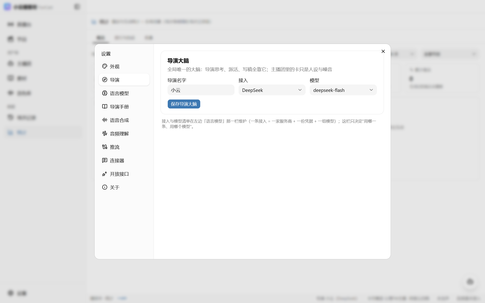

# 界面一览

## 直播台

开播主控台：顶部是节目选择与播控（启动/暂停/跳过/结束/导出/急停），中间是话术池队列、评论流、事件流，右侧是和主播的对话框与操作面板。

## 节目

节目列表与配置：内容形态、播出方式、播完策略、互动开关、触发器清单。预制节目的底稿与音频状态也在这里管理。

## 主播团

人设卡列表。点击卡片弹窗配置：性格、口癖、禁区、编剧模式、音色挂载。

## 知识库

商品与资料。商品价格有护栏——主播报价只能出自知识库核过的口径，不会自己编数字。

## 音色库

云端音色与克隆音色管理。传一段干净录音即可克隆店家的声音；每个音色可以先试听再挂到节目上。

## 数据

观众画像（主播自动记住来互动的观众）、节目摘要（下播自动复盘）、用量看板（LLM tokens / TTS 字符，按节目归组 + 30 天趋势）。

## 设置

外观、语言模型、主播手册（全局提示词）、语音合成、推流、连接器。

